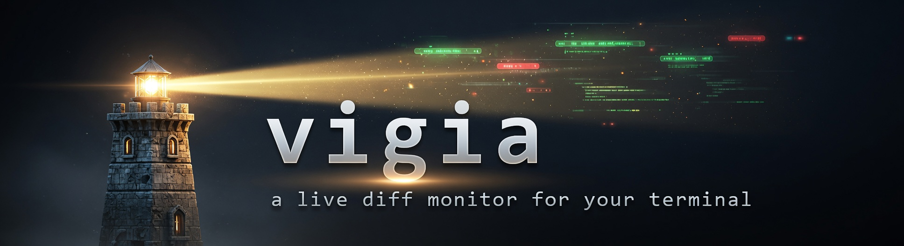
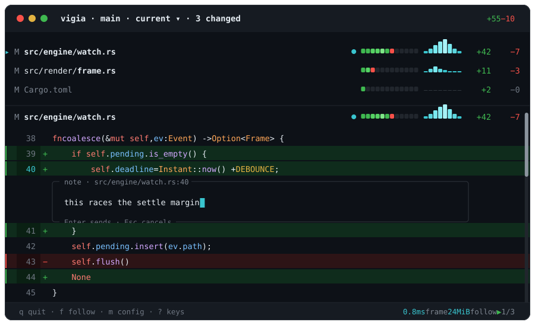

<div align="center">



### The terminal pane your **coding agent** works beside.

*Portuguese: a watchman, the one who keeps watch. At sea, also a porthole.*

[](https://crates.io/crates/vigia) [](https://crates.io/crates/vigia) [](https://github.com/breferrari/vigia/actions/workflows/ci.yml) [](https://github.com/breferrari/vigia/blob/main/LICENSE) [](https://crates.io/crates/vigia)

**Your agent writes in one pane. `vigia` watches in the pane beside it, and carries your words back.**

It shows the working-tree diff live, as the agent writes it. Click a line, type one sentence, and it goes to the agent that wrote that line.

</div>



---

## 🔭 Why

**This is not a diff viewer you open.** A diff viewer shows *what changed* once, when you ask. A coding agent edits **fast**, across **many files**, often while you are reading something else. Its scrollback tells you what it *said* it did, not what actually changed on disk.

`vigia` shows what actually changed, continuously, without you touching it. It also sends a sentence from you back to the agent, tied to the line you were looking at. One pane writes. One pane watches, and answers.

|  |  |
|---|---|
| 🤖 **For the pane beside the agent** | Zero input. It follows the newest change and scrolls to it on its own |
| ✍️ **Talk back to a line** | Click a line number, type, `Enter`. Your agent gets the file, the line and your words |
| 🖼️ **Pictures, not bytes** | A changed image, SVG or PDF shows its old and new pictures side by side (from 1.2.0, unreleased) |
| 🕰️ **Look back without leaving** | `B` stands the pane anywhere in the branch's history, and back |
| 🪶 **Cheap enough to leave open for a week** | Zero wakeups while idle. Under 5% memory drift over 24 hours |
| 📐 **Fits half a laptop screen** | Legible at 40 columns, because that is the actual pane you have |
| ⌨️ **Nothing to learn first** | `?` draws every gesture, `m` every on/off setting. `~/.config/vigia/config` decides what it opens as |

> [!NOTE]
> **A monitor, not a reviewer.** It can browse history and send your notes to the agent, but it asks nothing of you. A reviewer is something you launch, work through and finish. `vigia` is already open, correct before you touch it, and still correct if you never do.

---

<a id="talk-back"></a>

## ✍️ Talk back to the line

You see a line you want changed. Click its line number, type one sentence, press `Enter`.

```
  40 +          self.deadline = Instant::now() + DEBOUNCE;
     ✎ should this reset on every event, or just the first?
```

1. **The pane writes the note first.** Each note is a file in a directory kept for this worktree under your state directory, never inside the worktree or `.git`. So a note survives a restart of the pane or the agent, and two repositories never see each other's notes.
2. **Then it hands the note to the agent.** The footer says `sent` when a registered agent session took it, and `noted` when none did and the note is waiting for the agent to look. `sent` means the session took the line. It does not mean the agent has read it. If the agent is waiting on a permission prompt, the note queues and is handled once you answer (observed with Claude Code 2.1.304).
3. **The agent gets the file, the line, your words and the code around it**, as plain text:

   ```
   vigia note on src/engine/watch.rs:40

   should this reset on every event, or just the first?

     37 |     }
     38 |     fn coalesce(&mut self, ev: Event) -> Option<Frame> {
     39 |         if self.pending.is_empty() {
   > 40 |             self.deadline = Instant::now() + DEBOUNCE;
     41 |         }
     42 |         self.pending.push(ev);
     43 |         None

   Resolve it with the vigia MCP server: resolve(id: "65e47ff14944b-79fa-0", note: "<one line saying what you did>").
   ```

4. **The agent fixes the line and resolves the note** with one line saying what it did. That line appears under your note, and then the note leaves. If the agent needs to ask you something, it can `reply` instead and leave the note open.

`vigia` calls no model, summarises nothing and judges nothing. It carries your words, and the agent answers.

**How it reaches the agent.** `vigia mcp` is an MCP server with three tools, `notes`, `reply` and `resolve`. Two hooks do the rest: `vigia mcp register` records a running Claude Code session so `Enter` can post the note straight into it, and `vigia mcp pending` puts one line in front of your next prompt when a note is waiting.

| | MCP server | Posted into a running session | Line before your next prompt |
|---|---|---|---|
| **Claude Code** | yes | yes | yes |
| **Any other MCP client** (Codex, for one) | yes | no | yes, with a prompt hook |

Without the live post, a note waits until the agent next calls `notes` or you send your next prompt.

**How fast.** From `Enter` to the note arriving on the session's socket. Measured 2026-10-20: 3.4 ms at the median and 21 ms at the slowest, over 32 notes on an Apple M1 Max with a release build ([how](https://github.com/breferrari/vigia/blob/main/docs/NOTES.md#how-fast-a-note-leaves)). How soon the agent acts on it after that is up to the agent.

**Set it up once**, for every project you open:

```sh
claude mcp add --scope user vigia -- vigia mcp
```

Then add the three hooks to `~/.claude/settings.json`. [**Notes to the agent**](https://github.com/breferrari/vigia/blob/main/docs/NOTES.md) has the hooks, what each note state means, other agents, and the small print.

---

## 🚀 Install

```sh
cargo install vigia                          # with a Rust toolchain
brew install breferrari/tap/vigia            # Homebrew, macOS and Linux
```

Or a prebuilt binary with no toolchain at all:

```sh
# macOS and Linux
curl --proto '=https' --tlsv1.2 -LsSf https://github.com/breferrari/vigia/releases/latest/download/vigia-installer.sh | sh

# Windows
powershell -ExecutionPolicy Bypass -c "irm https://github.com/breferrari/vigia/releases/latest/download/vigia-installer.ps1 | iex"
```

[**Installing**](https://github.com/breferrari/vigia/blob/main/docs/INSTALL.md) covers the release archives, checking a download, and upgrading on Windows while an agent session is open.

## 🧭 Your first five minutes

1. **Point it at a repo.** `vigia` watches the tree you are in, or `vigia ~/code/some-repo`. Leave it in the pane beside your agent. There is nothing to configure and nothing to press.
2. **Let it follow.** As your agent writes, files appear in the pinned list at the top and the diff scrolls to whatever landed last. The sparkline says *when*, the heat strip says *where in the file*, the counters say *how much*.
3. **Say something about a line.** Click a line number, type, `Enter`, as in [Talk back to the line](#talk-back).
4. **Look back when you need to.** `B` lists every place the pane can stand: the live tree, the branch point, or any commit behind it. `Esc` and you are back.
5. **Forget the rest.** `?` puts every gesture on screen, and `m` every on/off setting.

---

## 👀 What you see

```
   header  │  my-repo · main · current ▾ · 3 changed                   +55 -10
           │
     list  │  ▸ M src/engine/watch.rs   ●  ■■■■■■■■■■■■  __▁▂▆█__   +42    -7
           │    M src/render/frame.rs      ■■■■■■■■■■■■  ________   +11    -3
           │    M Cargo.toml               ■■■■■■■■■■■■  ________    +2    -0
     rule  │  ───────────────────────────────────────────────────────────────
     diff  │    M src/engine/watch.rs   ●  ■■■■■■■■■■■■  __▁▂▆█__   +42    -7
           │    @@ -38,7 +38,9 @@
           │    38    fn coalesce(&mut self, ev: Event) -> Option<Frame> {
           │    39 +      if self.pending.is_empty() {
           │    40 +          self.deadline = Instant::now() + DEBOUNCE;
     rule  │  ──────────────────────────────────────────────────────────────
   status  │  q quit · f follow · m config · ? keys   3.1ms frame  25MiB  follow ▶  1/3
```

Each row answers one question: the caret says where you are, the pulse `●` which file was written last, the note mark whose turn it is, the heat strip **where** in the file the change is, the sparkline **when** it changed, and the counters **how much**. The diff is syntax highlighted, and the words that changed inside a line are lit brighter than the line around them.

**A changed picture shows as pictures** (from 1.2.0, unreleased). A changed image, SVG or PDF draws its old and new versions side by side, with the changed pixels marked. Terminals that draw Kitty graphics, Sixel or iTerm2 images (kitty, Ghostty, iTerm2, WezTerm, foot, Windows Terminal) draw them sharp. Everywhere else they draw in half-blocks, which need 24-bit colour. PDFs need a release binary or Homebrew: a `cargo install` build shows a changed PDF as binary.

[**Reading the pane**](https://github.com/breferrari/vigia/blob/main/docs/READING.md) explains every signal, how a file finds its language, and what the pane never selects.

## ⌨️ Keys

**Keys**

| | |
|---|---|
| `j` `k` `↑` `↓` | scroll a row |
| `n` `p` `→` `←` | next / previous file |
| `f` | follow the newest change, or stop |
| `s` | one file, or the whole diff |
| `a` | show or hide staged changes |
| `B` | everywhere else it can stand |
| `Ctrl+L` | redraw, and send pictures again after a tmux reattach |
| `?` `Esc` | every gesture, on screen |
| `q` `Ctrl+C` | quit |

The mouse works too: the wheel scrolls what you point at, a click on a file jumps to it, and dragging the diff copies those rows. [**Keys and mouse**](https://github.com/breferrari/vigia/blob/main/docs/KEYS.md) has every key and gesture.

---

## ⚡ Promises

Budgets, not hopes. Each one has a test that fails when it is missed. Every regression **fails the build** except memory drift, which a scheduled soak checks.

| | | |
|---|---|---|
| 🔔 | **Event driven** | Zero wakeups while idle. No filesystem event, no work. Never a polling timer |
| 🚀 | **Instant start** | Under 50ms to first paint |
| 🌊 | **Streaming** | First paint under 100ms, even on a 100,000 line diff |
| 🎞️ | **60fps** | Frame time under 16ms at p99, *while files are being written* |
| ♻️ | **Incremental diff** | Re-diff cost scales with what changed, not with your worktree |
| 🖍️ | **Incremental highlight** | Re-parse cost scales with your edit, not the file |
| 🪶 | **Flat over days** | Under 5% memory drift across 24 hours. No retained temp files |
| 🧘 | **Correct untouched** | Follows the newest change and scrolls to it with no input |
| 📐 | **Narrow panes** | Legible at 40 columns |
| 🚪 | **Clean exit** | Terminal restored on every exit it can observe: the quit key, `Ctrl+C`, an error, a panic, or the first kill from outside |

## 🎨 Make it yours

A palette, a colour depth, which drawing glyphs your font carries, how a changed image is drawn (from 1.2.0, unreleased), what the pane opens as, and whether it looks for updates. Every one has a default, and the defaults are what ships.

```sh
VIGIA_THEME=dark vigia          # ansi, dark, light or system, or a path to your own
NO_COLOR=1 vigia                # every ladder collapses to something readable
```

[**Configuration**](https://github.com/breferrari/vigia/blob/main/docs/CONFIG.md) is the whole of it, and [**Theme**](https://github.com/breferrari/vigia/blob/main/docs/THEME.md) names every colour the pane draws.

---

## 📚 Documentation

| | |
|---|---|
| [Notes to the agent](https://github.com/breferrari/vigia/blob/main/docs/NOTES.md) | Setting up notes, what each state means, other agents |
| [Reading the pane](https://github.com/breferrari/vigia/blob/main/docs/READING.md) | Every signal on screen, highlighting, changes inside a line |
| [Keys and mouse](https://github.com/breferrari/vigia/blob/main/docs/KEYS.md) | Every key and gesture, and the small print |
| [Installing](https://github.com/breferrari/vigia/blob/main/docs/INSTALL.md) | Every install path, checking a download, upgrading on Windows |
| [Configuration](https://github.com/breferrari/vigia/blob/main/docs/CONFIG.md) | The config file, its keys, colour depth, glyphs and themes |
| [Theme](https://github.com/breferrari/vigia/blob/main/docs/THEME.md) | Every colour the pane draws |
| [Built with](https://github.com/breferrari/vigia/blob/main/docs/ARCHITECTURE.md) | The dependencies, what each one does, and the numbers behind the promises |
| [mcs pack](https://github.com/breferrari/vigia/blob/main/docs/TECHPACK.md) | Installing the notes setup with `mcs` |

These pages track `main`. For a released version, browse its tag.

**About the picture at the top.** It is a mockup drawn with `VIGIA_THEME=dark`, not a screenshot, and everything in it draws in the real pane. One difference: the real header shows your worktree's name where the picture says `vigia`.

## 🗺️ Status

Released, and built in the open, spec first. [`ROADMAP.md`](https://github.com/breferrari/vigia/blob/main/ROADMAP.md) is the live plan, [`SPEC.md`](https://github.com/breferrari/vigia/blob/main/SPEC.md) the contract it is built against, and [`CHANGELOG.md`](https://github.com/breferrari/vigia/blob/main/CHANGELOG.md) every released version.

## 🏷️ The name

*Vigia* is Portuguese: a watchman, a lookout, the one who keeps watch. At sea it also means a porthole, the small round window you look through.

Both readings are the tool. It watches, and it is the window you watch through.

It is also the verb, third person. So `vigia .` reads as a sentence.

## 🤝 Contributing

Issues and pull requests are welcome, and a plain bug report needs two lines: what you expected, what happened. [`CONTRIBUTING.md`](https://github.com/breferrari/vigia/blob/main/CONTRIBUTING.md) has the rest, including the one real ask: `SPEC.md` is read before code. Some things this project will not do, such as staging, committing and rebasing, AI features of its own, git remote operations, or a GUI. [`ROADMAP.md`](https://github.com/breferrari/vigia/blob/main/ROADMAP.md#non-goals-permanent) lists them.

---

<div align="center">

**MIT** · Built in the open · [SPEC](https://github.com/breferrari/vigia/blob/main/SPEC.md) · [ROADMAP](https://github.com/breferrari/vigia/blob/main/ROADMAP.md) · [CHANGELOG](https://github.com/breferrari/vigia/blob/main/CHANGELOG.md) · [Issues](https://github.com/breferrari/vigia/issues)

</div>
