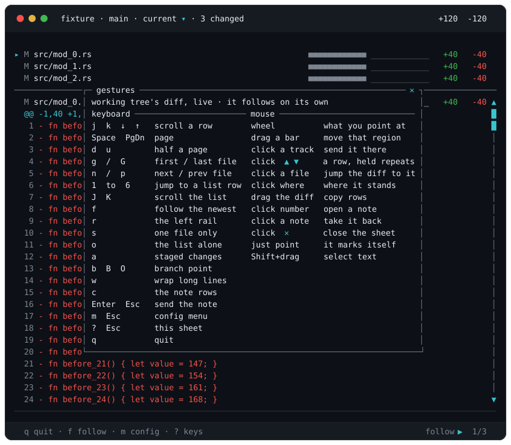

# Keys and mouse

`?` draws every gesture over the pane, keyboard and mouse side by side:

**Keys**

| | |
|---|---|
| `j` `k` `↑` `↓` | scroll a row |
| `Space` `PgDn` `PgUp` | page |
| `d` `u` | half a page |
| `g` `G` | first / last file |
| `n` `p` `→` `←` | next / previous file |
| `1` to `6` | jump to that list row |
| `J` `K` | scroll the pinned list |
| `f` | follow the newest change, or stop |
| `r` | list beside the diff, or above it |
| `s` | one file, or the whole diff |
| `o` | the file list alone, no diff |
| `a` | show or hide staged changes |
| `b` | stand at the branch point |
| `B` | everywhere else it can stand |
| `O` | that commit alone, or everything since it |
| `w` | wrap a long line onto the row below, or clip it |
| `c` | show or hide note rows |
| `Enter` `Esc` | in a box: send, or cancel |
| `m` `Esc` | every on/off setting, in one box |
| `?` `Esc` | all of this, on screen |
| `q` `Ctrl+C` | quit |

**Mouse**

| | |
|---|---|
| wheel | scroll what you point at |
| drag a bar | move that region |
| click a track | send it there |
| click `▲` `▼` | one row, and repeats held |
| click a file | jump the diff to it |
| click the position | everywhere it can stand |
| drag the diff | copy those rows |
| click a line number | open a note there |
| click a note's side | take that note back |
| click `✕` | close the sheet |
| just point | it marks itself |
| `Shift`+drag | your terminal selects text |

**`m` opens every on/off setting in one box**, the ones above and the two only the config file sets, with `↑` `↓` to move and `Space` to flip. `Save settings` keeps what you flip for next time, and `Reset to defaults` puts every row back. **`?` draws every gesture on this page**, a page at a time where the pane is small. Both draw over rows that are already there, and `Esc` puts either away.

<b>The small print on the keys</b>

 

`Ctrl+D` quits too, and `Home` / `End` are aliases for `g` / `G`, `Shift+↑` / `Shift+↓` for `J` / `K`.

**`Ctrl+L` draws the pane again, pictures included.** Press it after you reattach tmux from another terminal, where the pictures would otherwise stay blank.

**`Shift`+drag selects text because your terminal does it, not because `vigia` does.** The pane holds the mouse so the wheel and the scrollbars work, and every terminal keeps a modifier that hands selection back for as long as you hold it: `Shift` on xterm, GNOME Terminal, Konsole, Windows Terminal, kitty and WezTerm, and **`Option`** on iTerm2, checked by hand on Windows Terminal. You get the terminal's own highlight and the terminal's own clipboard, which means it works over SSH and inside tmux. What it copies is what is on screen, so a path the pane had to shorten is copied short.

**Dragging the diff is for that case.** It sends the rows rather than the cells, so a line the pane clipped arrives whole, a line `w` wrapped arrives as one line, and a file heading arrives as its path however short the pane drew it. Let go and it is sent, and the footer says what went. Your terminal has to allow it: the escape it uses is off by default in a few of them, there is no reply to read, and so nothing can promise it arrived.

The digits count **rows on screen**, not files in the repository: `3` is the third row the list is drawing, so it means a different file once you have scrolled the list with `J`. A digit naming a row that is not drawn does nothing at all, and neither does `n` at the last changed file or `p` at the first.

It shows the working tree against the **index**, untracked files included, and it follows whatever changed last until you scroll away. With nothing to show it says so, and says where the work went if it went to the index.

