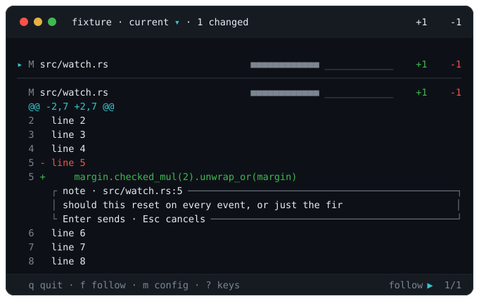

# Notes to the agent

Point at a line number in the diff and it becomes a pencil `✎`. Click it, type one sentence, press `Enter`.

```
  41 +      self.deadline = Instant::now() + DEBOUNCE;
     ✎ should this reset on every event, or just the first?
```

While you type, the box sits under the line it is about, and every key belongs to it:



It goes to the agent in the other pane carrying the file, the line and your words. The answer comes back on a row under yours.

**Code in that answer is drawn as code.** A fenced block loses its fences, keeps its indentation where the pane has to wrap it, and takes the same colours the diff above it takes, from the grammar the fence names or the file the note is pinned to. A word in backticks loses them too. A fence means backticks, three or more, closed by at least as many, so a longer fence holds a shorter one whole; an indented block is left as words, because nothing can tell one from a list item that ran on. A fence naming a language the bundled grammars do not have is left uncoloured rather than coloured as the file it is pinned to, which the agent has just said it is not. What you copy is still what the agent wrote, backticks and all.

That is the whole of it. `vigia` calls no model, summarises nothing and judges nothing. It carries your words, and the agent answers.

## What a note says while it waits

Every note draws under its line with one word for where it stands.

Four notes on one file, each in a different state:


| | |
|---|---|
| `open` | Sent. The agent has not looked yet |
| `seen` | The agent has read it |
| `changed` | You edited the line underneath, so the row draws dim |
| `gone` | The line left the diff, and the note moved under the file's heading |
| `adrift` | The whole file left the diff. The footer counts it beside the position as `2 notes · 1 adrift` |

**No state loses a note.** An adrift one is back under its line the moment the file returns. A line's number stays lit while a note is on it, and the file's own row in the list carries `✎` while you are waiting and `↳` once the agent has answered, which is how you find one note in a run of thirty files. `c` hides the note rows without hiding those marks.

**When the agent resolves one**, its answer arrives on a row under the note, holds for a minute, and the note leaves.

**To take one back**, point at the note's left side. The cell under your pointer becomes `✕`, and clicking it withdraws the note whether or not the agent has answered. Emptying the box and pressing `Enter` does the same. A note the agent resolved in the meantime is left alone, because its answer is already on its way to you.

**Where they live.** One directory per worktree under your own state directory: `$XDG_STATE_HOME/vigia/`, or `~/.local/state/vigia/`, and `%LOCALAPPDATA%\vigia\state\` on Windows. Never inside the worktree and never inside `.git`, because a monitor that wrote where it watches would wake itself.

## Setting it up

Two pieces, and both go in your own config rather than in the repository, because `vigia` is yours and so is the pane you run it in.

**1. Give the agent the server.** `vigia mcp` is an MCP server over stdio:

```sh
claude mcp add --scope user vigia -- vigia mcp
```

`--scope user` writes `~/.claude.json`, which covers **every project you open on this machine** and stays private to you. Claude Code tells the server which project a session is in, so that one registration finds whichever worktree you are watching, and notes are kept per worktree, so two repositories never see each other's.

The agent gets three tools and one resource:

| | |
|---|---|
| `notes` | Lists what is open, each with its line's current number, the line's text and three lines either side, and marks them `seen` |
| `reply` | Writes a line under a note and leaves it unresolved |
| `resolve` | Closes one. Its line is required, because that line is what you watch arrive |

The resource is `vigia://notes`, and the server announces every change to the store, so an agent that subscribes hears about a note the moment you send it.

**2. Reach the session already running.** With the server alone your note waits until the agent next looks. Three hooks make it arrive instead, and they go in `~/.claude/settings.json`, which is the same scope as the line above: write them once, and every repository is covered.

```json
{
  "hooks": {
    "SessionStart": [
      { "hooks": [{ "type": "command", "command": "vigia mcp register" }] }
    ],
    "SessionEnd": [
      { "hooks": [{ "type": "command", "command": "vigia mcp register" }] }
    ],
    "UserPromptSubmit": [
      { "hooks": [{ "type": "command", "command": "vigia mcp pending" }] }
    ]
  }
}
```

`vigia mcp register` records the session's own socket beside the store when it starts and clears it when it ends. `Enter` then posts the note into that session directly, and a session sitting idle starts a turn on it, so the answer can arrive while you are still looking at the line. The footer says **sent** when a socket took the line and **noted** when nothing live did, so the note is waiting in the store. Nothing is written back, so *sent* is the honest word: it says the line went, never that it arrived.

`vigia mcp pending` works without a socket. It puts one line in front of your next prompt saying what your notes are waiting on: a read, a resolve, or you, once the agent has answered one with `reply` and left it with you. Nothing at all when nothing is pending.

<details>
<summary><b>Both steps in one command, if you already use <code>mcs</code></b></summary>

<br>

[`mcs`](https://github.com/mcs-cli/mcs) is a package manager for a Claude Code setup. It is not needed for any of the above and nothing here depends on it. If you already keep your setup that way, `techpack.yaml` at the root of this repository is a pack it can install:

```sh
mcs pack add breferrari/vigia
mcs sync --global
```

**Its `--global` is the scope both steps above already use**, under another name: machine-wide for your user, writing the server into `~/.claude.json` and the hooks into `~/.claude/settings.json`. What it adds is doing both at once, installing the binary with them, and putting back whatever moved when you run `mcs sync` again after an upgrade. `mcs doctor` names anything missing and the command that fixes it.

macOS and Linux only, because the pack installs the binary through Homebrew and its hooks are shell scripts. [`docs/TECHPACK.md`](TECHPACK.md) lists every component and what each one is.

</details>

<details>
<summary><b>Putting the server in the repository instead</b></summary>

<br>

`--scope project` is the one shape here that reaches anybody but you. It writes a `.mcp.json` at the root of the repository, and you commit it, so everyone who clones gets a `vigia` server whether or not they have `vigia` installed:

```json
{
  "mcpServers": {
    "vigia": { "command": "vigia", "args": ["mcp"] }
  }
}
```

Right when the whole team watches its diffs this way, and only then. If it is just you, the user-scoped line above is the one, and it already covers every repository on the machine.

</details>

<details>
<summary><b>The small print on the hooks</b></summary>

<br>

Both commands are safe to install once and forget, which is what makes them worth putting in your user settings at all: outside a repository, with no store, or with nothing open, they do nothing and say nothing, and a hook installed there runs in every project you open.

The socket is Claude Code's own, exported to hooks from v2.1.224, and v2.1.234 on native Windows. Below those the registration finds nothing to record and `Enter` still writes the note to the store, where the server and the `pending` line both reach it.

A user-scoped server is started from your own config directory rather than from the repository, so what tells it where to look is the project Claude Code names for it. That has been dependable since v2.1.238. On anything older it falls back to its working directory, which for a user-scoped server is not your worktree, and `--scope project` is the shape that works there.

`vigia` is not the session's child and nothing comes back down the socket, so whether the session acted on your note, held it behind a permission prompt or dropped it is not something the pane can tell you. And a note whose line has been removed from the diff arrives carrying its anchor alone, since there is no line left to quote.

</details>

## How fast a note leaves

Measured 2026-10-20 on an Apple M1 Max, macOS 27.0.1, with a release build of `main` at ccdce3f. A script started the binary in a pseudo-terminal at 100 by 90 cells, on a scratch repository with one changed file. A listening Unix socket was registered through `vigia mcp register`, fed a `SessionStart` payload on stdin and the socket and token in its environment, the way the Claude Code hook runs it. For each note the script clicked a line number with an SGR mouse report, typed a sentence, and took the time just before writing `Enter`. It took the time again when the second line, the note's frame, arrived on the socket.

Two runs of 16 notes each, since a pane that size fits 16 note boxes. Over the 32: 0.98 ms at the fastest, 3.40 ms at the median, 12.01 ms at the 90th percentile and 20.64 ms at the slowest.

That is the part `vigia` controls: the store write, the post on its own thread and the socket write. What the agent does after the line arrives is not measured here.

## Other agents

The server and `pending` work with any agent. The live push does not.

- **The server is plain MCP over stdio**, so any client can run it. For Codex: `codex mcp add vigia -- vigia mcp`. Claude Code tells the server which project it is in. Other clients do not, so the server serves the worktree it was started in. If your agent starts somewhere else, set the client's `cwd` for the server to the worktree. The server names the worktree in its handshake, so the agent can see which one it has.
- **`vigia mcp pending` reads nothing from its hook**, so any prompt hook that passes a command's output to the model can run it. Codex's `UserPromptSubmit` hook is one.
- **`vigia mcp register` is Claude Code's alone.** It records a socket that only Claude Code opens. Under any other agent a note waits in the store until the agent next calls `notes`, and the footer says **noted**.
