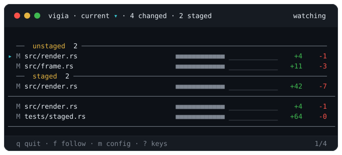
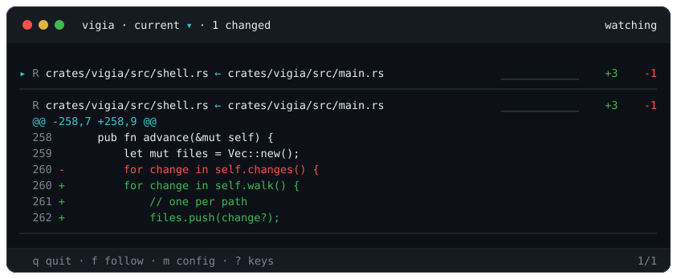
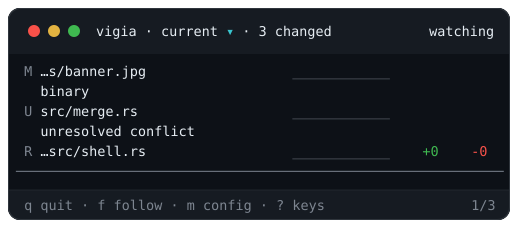

# Reading the pane

The list is **pinned**, so the signals stay on screen while you read the diff under them. Press `r` on a pane of 139 columns or more and it moves *beside* the diff instead, as a left rail, so a path sits against its own numbers rather than across a void that grows with the pane. It costs the diff real width, which is why you ask for it rather than the pane deciding: `r` again puts it back, and below 139 the key does nothing. The pane drawn above is narrower than that, and the stacked layout is the default at every width.

Press `s` and the diff shows **only the file the caret is on**. Scrolling stops at that file's two ends instead of carrying on past them into the next one, and the scrollbar measures the file rather than the whole changeset, so you are keeping one position in your head instead of two. It is follow's companion: `f` decides which file the pane goes to on its own, `s` decides how much of the rest of the tree your own scrolling reaches once it is there. `n`, `p`, the digits, a click on a listed file and follow itself all still move between files, and `s` again gives the whole diff back.

Press `a` and the pane adds **what is staged**, as a second run beside the first. Two labelled lists share the top panel, unstaged above staged, and every staged row draws its status letter in green so the two never blur together. The mark costs no width, so asking for the staged run never shortens a filename. It exists because `vigia` shows the working tree against the index, so an agent that stages its own work would otherwise leave the pane empty, which reads exactly like a clean tree. A file staged and then edited again appears in both runs, once for each diff, because they are two different changes. `a` again puts it back, and even with it off a blank pane says where the work went: `no unstaged changes · 3 staged`.

`src/render.rs` is in both runs: once for what is staged, once for the edit made after.

Every file gets the same row in both regions:

| | | Answers |
|---|---|---|
| `▸` | **caret** | 📍 *where you are.* The diff below is inside this file |
| `M` | **kind** | modified, added, deleted, renamed |
| `src/…` | **path** | which file. How brightly it is drawn is how recently it changed, and it is a link you can click |
| `●` | **pulse** | ⚡ the file written last |
| `✎` `↳` `✓` | **note mark** | 📝 your note is here, and where it stands |
| green `M` | **staged** | 📦 this row is what the index holds, not the working tree (`a`) |
| `■■■■` | **heat strip** | 🗺️ **where** in the file the change is |
| `__▁▂▆█` | **sparkline** | ⏱️ **when** it changed, over the last two minutes |
| `+42 -7` | **counters** | 📊 **how much**, in lines |

They exist separately because a glance can only ask one question. You read the one you came for and ignore the rest.

A renamed file names both paths, new first, as long as the row has room for both:

A file with no line diff says why instead of drawing nothing. Here a binary file, a merge conflict and a rename with no edit:

<b>📝 The note mark is <i>whose turn it is</i></b>

`✎` is a note you left that the agent has not answered. `↳` is one it has answered and you have not resolved, and it is the only one of the three that means the pane is waiting on **you**: it draws the same arrow the agent's reply draws under your line. `✓` is one just resolved, and it stays for as long as the note's departure does.

A file with several notes shows the one that matters most, so an answer beats a note still waiting and a resolved one never hides either. The shape is what carries the state, not the colour, so all three still read on a terminal with `NO_COLOR` set. And the slice of the heat strip the note sits in is tinted, so on a long file you can see roughly where in it the conversation is without opening it.

The column is kept on every row whether or not the file has a note, so nothing slides sideways when one arrives. It is the last thing dropped before the counters as the pane narrows, which puts it ahead of the pulse: a file that just changed says so in three other ways, and a file holding a conversation says so in one.

<b>🗺️ The heat strip is <i>where</i></b>

 

Cut the file into equal slices, top to bottom, twelve of them on an ordinary pane, and twenty-four or forty-eight on one wide enough to spare the columns, and colour each one by what happened inside it: **green** for lines added, **red** for removed, and a third colour where both. It is a map of the file you are *not* looking at, so a strip lit only at its right end says the change is at the bottom and you have not scrolled there yet. Brighter means more lines in that slice.

A slice nothing touched is still drawn, in a dark track colour, because a strip with holes in it would be a different shape per file and you could not compare two at a glance. On a narrow pane adjacent slices are summed and reclassified rather than dropped, so it stays a whole file at every width.

<b>⏱️ The sparkline is <i>when</i></b>

 

Twelve columns across the last two minutes, so each column is ten seconds, oldest on the left. A taller column is more bytes moving around that ten seconds, and a busier one is a hotter colour: on a terminal with 24-bit colour the height and the ink climb the same ramp together, so the shape reads at a glance and the colour confirms it. Every column always covers the whole two minutes between them: a narrow pane draws six columns of twenty seconds rather than the last minute, and a pane wide enough to spare the room draws twenty-four of five.

**Around, rather than in.** A save is a point event, so the raw samples are zero almost everywhere and drawing them gives you a spike train on a flat line rather than a graph. What the column draws is a **level**: the bytes near it, weighted by a six-second kernel that looks both ways, which is what reading a series of point events as a density means.

It is scaled **across every tracked file**, not against the row's own maximum, and that is the whole point: a row scaled to itself would draw full height the moment it was the busiest thing *it* had ever been, and you could not tell the file an agent is hammering from the file it touched once. A column with no writes draws a flat track `_` rather than nothing, for the same reason the heat strip draws its empty slices.

<b>⚡ The pulse, the caret, and what is <i>not</i> a selection</b>

 

The dot marks the file written last, and it moves when another file is written, so it **cuts rather than fades**. The path's own brightness is the same signal, wider and slower: every file in the newest burst draws brightest, and the file that just changed, one that changed recently, and one that has not, are three intensities of the same colour.

The caret `▸` is a different claim, and the only one about you: the diff below is inside this file. It is a marker, not a cursor. **Nothing on this pane is ever selected**: not the caret, not the row under your pointer. Nothing is remembered because you looked at it, no row becomes special by being pointed at, and the next key means exactly what it would have meant, unless you have a note box open, which is the one thing here you are inside until you leave it. Dragging the diff washes the rows you cross, and that is the exception that proves it: let go, they are on your clipboard, and the wash is gone. A line you left a note on stays marked, and that is not a selection either: you put it there, it outlives the pane, and it goes when the note does.

The counters lend colour only where it says something: a `-0` stays grey, because a zero is not reporting a removal.

## 🖍️ The diff itself is highlighted, in every language you write

**217 grammars**, so the languages a 2026 tree is actually made of are coloured rather than plain: TypeScript and TSX, Swift, Kotlin, Dart, Elixir, Julia, Zig, Nim, Crystal, F#, Solidity, Gleam, V, Odin, Elm, PowerShell, SCSS and Sass and Less, Vue and Svelte, TOML, Protobuf, GraphQL, Terraform, Dockerfile, CMake, Nix, and `go.mod` and `.gitignore` and `.env`, beside the C-family and scripting languages you would expect.

<b>🖍️ How a file finds its language, and the four it cannot</b>

 

The grammars are `bat`'s curated collection, which is the same set that tool highlights with, compiled into one dump the binary carries. Every one of their licences is reproduced in `NOTICE.md`, which ships in the release archives and in the published crate rather than only living here.

**Five steps decide the language**, in order, because an extension alone gets a surprising number of files wrong:

1. **A written rule**, where one extension has more than one honest answer. `.h` is Objective-C, whose grammar is a superset of C, so C headers colour fully and only C++-only constructs go plain. `.m` is Objective-C over MATLAB, `.v` is V over Verilog, `.jsx` borrows the TSX grammar, and `.sass` is Sass.
2. **The whole file name**, so `Dockerfile`, `CMakeLists.txt` and `go.mod` are found by name. This runs *before* the extension, so `CMakeLists.txt` is CMake rather than plain text.
3. **The extension**, with a leading-dot retry so `.gitignore` finds a grammar registered as `gitignore`.
4. **The nearest grammar**, for the four formats below.
5. **The first line**, which is how an extensionless script with a `#!` gets a language at all, and how a `.ts` file that is really a Qt translation file gets read as the XML it is instead of as TypeScript.

**Four formats have no grammar this stack can carry**, and they draw as their nearest relative rather than as nothing: `.astro` as HTML and `.bicep` as JavaScript, because both upstreams are written in a Sublime Text 4 dialect `syntect` does not implement and both extend exactly those; `.mdx` as Markdown and `.mojo` as Python, which they are supersets of. Carbon has no grammar anywhere in this format, so it draws plain. That step runs *after* the four above, so the day a real grammar lands it wins without anything being deleted.

A file type nothing recognises is not an error. It draws as plain diff text, because a monitor that refused a file it could not colour would have inverted its own job.

## 🎯 And *what* changed inside the line

A changed line sits on a calm wash of its own colour, and the words that actually changed sit in a **hotter patch of that same colour**. A renamed function in a long line reads as one bright token rather than a whole red line above a whole green one, and you find the edit without reading either line to its end.

The pairing is bounded on purpose. A removed line and the added line under it are compared token by token, and a pair that differs too much is left as two whole lines rather than confettied into unrelated highlights: past that bound there is no shared shape left to point at. The line numbers of a changed row take a slightly darker tone of the same wash, so the gutter reads as its own column without a border being spent on one.

All three are backgrounds, so they need 24-bit colour and they leave together below it. What is left there is what was always there: the `+` and `-` column, and the left bar beside it.
